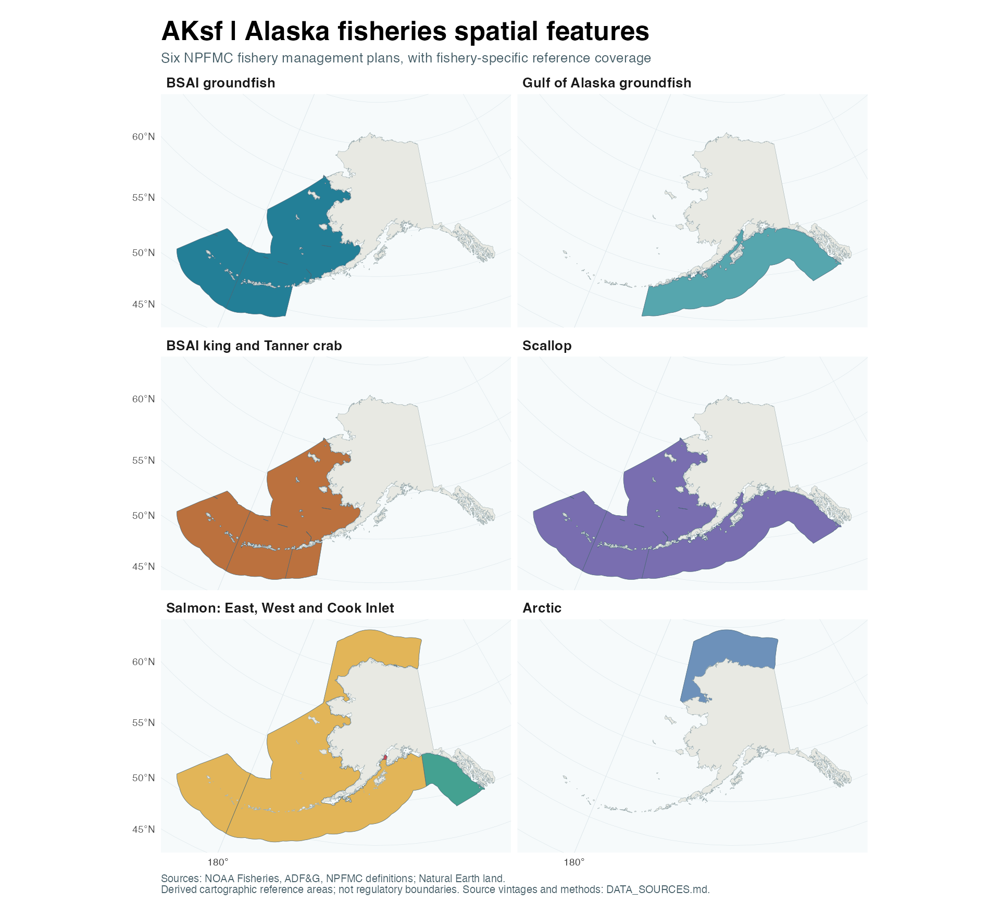

# AKsf — Alaska Fisheries Spatial Features

An R package for scientific maps of Alaska fisheries, modeled after the
layer-based approach of [quantifish/nzsf](https://github.com/quantifish/nzsf).
Combine bundled `sf` polygons with `ggplot2`, retain agency area codes, and
map the Aleutians continuously across the dateline.

**Version 0.1.0: a reproducible cartographic reference, not a regulatory boundary product.**
Agency snapshots and analytical derivatives are identified separately.
The package is independent of NOAA, ADF&G, and NPFMC and implies no endorsement.

## Install

```r
install.packages("remotes")
remotes::install_github("jimianelli/AKsf")
```

A private repository requires an authenticated GitHub token with access. From a
local checkout, use `R CMD INSTALL .`. Installing from source requires the usual
`sf` dependencies (GDAL, GEOS, PROJ, and UDUNITS); CRAN binaries include these on
supported macOS and Windows installations. Maps use bundled data and need no
network connection after installation.

## Make a map

```r
library(AKsf)
library(ggplot2)

ggplot() +
  plot_fmp_areas(c("BSAI_GF", "GOA_GF"), mapping = aes(fill = fmp_id),
                 colour = "white", linewidth = 0.25) +
  plot_reporting_areas(fill = NA, colour = "grey35", linewidth = 0.15) +
  plot_coast(fill = "grey90", colour = "grey55", linewidth = 0.15) +
  coord_aksf() +
  theme_aksf() +
  labs(fill = "FMP", title = "Alaska groundfish management",
       caption = "AKsf reference geometry • NOAA / ADF&G • Natural Earth land")
```



## Included data

| Dataset | Contents | Access |
|---|---|---|
| NOAA/NMFS reporting areas | 25 source features; 24 codes, including 550 | `get_reporting_areas()` |
| ADF&G groundfish statistical areas | 1,735 six-digit areas; native hierarchy and waters codes | `get_statistical_areas()` |
| ADF&G groundfish registration areas | Eight letter-coded areas | `get_registration_areas()` |
| NPFMC FMP reference areas | Six plans; eight polygons, including three salmon areas | `get_fmp_areas()` |
| Alaska land | Natural Earth 1:10 million, including the western Aleutians | `get_coast()` |

Each spatial getter has a corresponding `plot_*()` helper that returns a
`geom_sf` layer. Data are also available through `data("fmp_areas")`, etc.
`get_fmp_catalog()` describes every plan; `get_sources()` returns the source
manifest as JSON text.

```r
ai <- get_reporting_areas(c("541", "542", "543"))
cook <- get_registration_areas("H")
stat <- get_statistical_areas()
# Preserve character codes when joining fish-ticket data:
stopifnot(all(nchar(stat$area_code) == 6L))

# Select federal polygons, not state or international waters:
federal_stat <- stat[stat$WATERS_CODE == "FED", ]

# Work in geographic coordinates when needed:
ai_ll <- get_reporting_areas(c("541", "542", "543"), proj = 4326)
```

## FMP coverage

| Plan ID | Spatial representation |
|---|---|
| `BSAI_GF` | ADF&G federal BSAI polygons clipped to the NOAA reporting envelope |
| `GOA_GF` | ADF&G federal GOA polygons clipped to the NOAA reporting envelope |
| `BSAI_CRAB` | BSAI plus federal GOA waters west of Scotch Cap Light, per the Crab FMP |
| `SCALLOP` | Federal BSAI and GOA coverage combined |
| `SALMON` | East, West, and Cook Inlet EEZ areas; methods and source-vintage limits below |
| `ARCTIC` | NOAA’s published Arctic Closure geometry |

These plans are listed in the [NPFMC FMP library](https://www.npfmc.org/library/fmps-feps/).
FMPs can overlap; summing their areas double-counts water. Halibut/IPHC regulatory
areas are not an additional NPFMC FMP and are not bundled in this version.

Salmon follows the three-area structure in the **October 2024 FMP**, including
Cook Inlet north of 59°46.15′ N. The West polygon comes from NOAA’s ATB service
(last edited in 2023), with Cook Inlet explicitly removed. Its Prince William
Sound and Alaska Peninsula exclusions are inherited from that source, not
independently reconstructed or certified against every subsequent amendment.
The East and Cook Inlet polygons are derived from ADF&G federal-water polygons.

## Conventions and limits

- Default output: **NAD83 / Alaska Albers, EPSG:3338**, in metres. This is AKsf’s
  mapping default, not a universal NOAA or ADF&G source CRS. Geographic source
  snapshots are requested in WGS84 (EPSG:4326); datum transformations use PROJ.
- Longitudes follow the agency geographic coordinate convention. Do not crop
  Alaska with a naive `xmin < xmax` longitude box across the dateline. Use the
  projected getters or transform your points to `proj_aksf()`.
- Native agency fields remain intact; `area_code`, `area_name`, `authority`,
  `area_type`, and provenance fields support a consistent interface. ADF&G’s
  registration/district/subdistrict/section/sector/statistical hierarchy is
  retained, not replaced by an invented universal grid.
- NMFS reporting area **550 is international water** and is excluded by default.
  Request `include_international = TRUE` to include it. Reporting area 523 has
  two published features, both retained. Reporting polygons include some state
  waters and must not be treated as an EEZ boundary.
- FMP geometries are **derived reference maps**. Source vintages differ, and
  retrieval date is not effective date. There is no historical-boundary query.
  Check current regulations for enforcement, navigation, fishing eligibility,
  or boundary-sensitive catch allocation.
- The Natural Earth land layer is generalized. It is not a NOAA shoreline or a
  baseline from which to calculate the 3-nautical-mile state-water limit.
- This first release does not bundle bathymetry, species-specific closures,
  crab stock boundaries, salmon district grids, or every ADF&G fishery layer.

Read [DATA_SOURCES.md](DATA_SOURCES.md) for methods, exact sources, known limits,
and dataset licensing. The [tutorial](vignettes/AKsf.Rmd) demonstrates mapping
and safe spatial joins.

## Rebuild and validate

```sh
python3 data-raw/download.py          # caches raw agency responses
Rscript data-raw/build-data.R         # builds compressed sf datasets
Rscript -e 'roxygen2::roxygenise()'
R CMD build .
R CMD check AKsf_0.1.0.tar.gz --no-manual
```

Use `python3 data-raw/download.py --refresh` only for an intentional source
update. Object-ID batching checks completeness, and the manifest records URLs,
retrieval times, feature counts, and SHA-256 checksums. Raw downloads are ignored
by Git; the bundled `.rda` files pin the release. CI runs package checks on
Linux, macOS, and Windows without fetching live spatial data.

## Relationship to nzsf

AKsf follows nzsf’s R-package layout (`R`, `data`, `data-raw`, `man`, `tests`,
`vignettes`) and `get_*()` / `plot_*()` pattern. It is a fresh implementation,
not a renamed copy of New Zealand data or projection assumptions. The reference
checkout inspected was `442c8803ea01580c3ff00062c8b02f87075922dc`.
Credit to Darcy Webber and the nzsf contributors for the package design.

Code: MIT. Agency and Natural Earth data have their own attribution and usage
terms; see [LICENSE-DATA.md](LICENSE-DATA.md).
