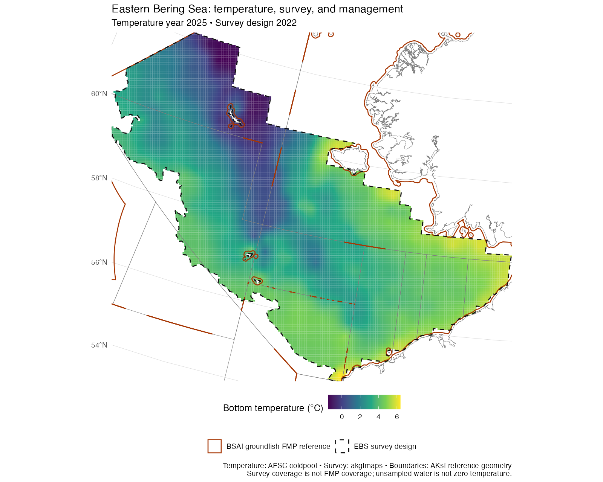

# AKsf and the AFSC GAP mapping ecosystem

AKsf complements these projects, but overlaps substantially with **akgfmaps**.
For an existing AFSC survey workflow, keep akgfmaps as the survey-data backbone
and add AKsf when its NPFMC plan reference layers or interface are useful.
There is no need to replace a working akgfmaps map merely to draw NMFS areas.
These are optional integrations, not mandatory package dependencies.

## Overlap, redundancy, and added value

| Capability | Existing AFSC implementation | AKsf overlap or enhancement | Recommended use |
|---|---|---|---|
| NMFS reporting/statistical areas | [akgfmaps::get_nmfs_areas()](https://github.com/afsc-gap-products/akgfmaps/blob/main/R/get_nmfs_areas.R) | Substantial duplication of the same area system; AKsf preserves source fields, adds character identifiers, and excludes international 550 by default. Snapshots are not identical. | Choose one source per analysis; compare codes, dates, and geometries before switching. |
| ADF&G management/statistical areas | [akgfmaps::get_adfg_areas()](https://github.com/afsc-gap-products/akgfmaps/blob/main/R/get_adfg_areas.R) | Substantial overlap. AKsf exposes the groundfish statistical and registration layers separately with native hierarchy and source provenance. | Keep fishery scope explicit. AKsf is not a complete inventory of ADF&G fisheries. |
| Coastline, CRS, and plotting | [akgfmaps base layers](https://github.com/afsc-gap-products/akgfmaps/blob/main/R/get_base_layers.R) include Alaska/Canada/Russia land and bathymetry; support EPSG:3338. | AKsf's Natural Earth land, projection helper, and ggplot layers duplicate general mapping facilities. Its land is less detailed. | Prefer akgfmaps for survey basemaps, detailed coast, and bathymetry; AKsf offers compact composable layers. Do not stack duplicate coastlines. |
| NPFMC FMP reference catalog | akgfmaps has NMFS/ADF&G area attributes and other management geography. | AKsf adds a single documented six-plan catalog and eight reference features, including three salmon areas and an explicit crab/groundfish boundary distinction. | Add plan context to survey or environmental maps. This is convenience and documentation, not new regulatory authority. |
| Survey areas, strata, stations, design history, ESR and INPFC regions | [akgfmaps](https://github.com/afsc-gap-products/akgfmaps) | AKsf does not provide these. FMP areas cannot substitute for survey strata or footprints. | Use akgfmaps; record survey design year separately from observation year. |
| Temperature/salinity surfaces and cold-pool time series | [coldpool](https://github.com/afsc-gap-products/coldpool) | AKsf adds management-area context, not environmental observations or index calculations. | Use upstream products and methods; overlay AKsf vectors in the raster CRS. |
| Navigation-software exports and operational survey layers | [navmaps](https://github.com/afsc-gap-products/navmaps) already draws survey layers from akgfmaps. | AKsf supplies optional reference features to an existing sf export workflow. It adds no navigation engine, hazards, or route planning. | Let navmaps handle supported export formats. AKsf reference boundaries are unsuitable for navigation or enforcement. |

**Do not create a second copy of the AFSC stack in AKsf.** Survey geometry,
interpolation, cold-pool indices, bathymetry, and software-specific exporters
remain upstream. AKsf's role is a small management-context layer with documented
provenance. All three projects retain their own licenses, attribution, and
release cycles; their data and code are not bundled here.

## Concrete differences found during review

At the commits below, AKsf contains 24 unique reporting codes, all present in
akgfmaps; akgfmaps additionally contains `530`. This is a code-inventory comparison,
not evidence that shared-code polygons are spatially identical. AKsf stores two
features for `523`. Dissolve by code before one-to-one area comparisons, and never
assume one row per identifier. AKsf excludes `550` from its default getter;
akgfmaps' getter retains it. Set the inclusion rule explicitly before comparison.

For ADF&G, both carry `STAT_AREA`, but field names and source snapshots differ.
For example, akgfmaps carries `WATERS_COD` and `FMP_AREA_C`; AKsf retains
`WATERS_CODE` and `FMP_AREA_CODE`. AKsf's `area_code` is a six-character code.
Normalize identifiers deliberately and inspect duplicate counts before joining.
Do not append both providers' copies as if they represented separate areas.
No polygon-equivalence or historical reconciliation is claimed here.

## 1. Add AKsf FMP context to an akgfmaps survey map

```r
# Install once: remotes::install_github("afsc-gap-products/akgfmaps")
library(AKsf)
library(ggplot2)
survey <- akgfmaps::get_base_layers(
  select.region = "sebs", design.year = 2025, set.crs = "EPSG:3338"
)
ggplot() +
  geom_sf(data = survey$akland, fill = "grey90", colour = NA) +
  geom_sf(data = survey$survey.strata, fill = NA, colour = "grey65") +
  geom_sf(data = survey$survey.area, fill = NA, colour = "blue") +
  plot_fmp_areas("BSAI_GF", fill = NA, colour = "orange3") +
  coord_aksf(xlim = survey$plot.boundary$x,
             ylim = survey$plot.boundary$y, expand = FALSE) +
  theme_aksf()
```

`design.year` selects a design, using the closest earlier available year when
necessary; it does not filter temperature observations. Use `sebs` explicitly:
akgfmaps' `ebs` selector includes both southern and northern survey definitions.

## 2. Overlay coldpool temperature, survey extent, and management boundaries

The runnable [survey-temperature.R](examples/survey-temperature.R) uses upstream
`.rda` and GeoPackage files directly, so it does not require installation of the
entire AFSC dependency stack. Install AKsf and `terra`, then supply local checkouts:

```sh
Rscript docs/examples/survey-temperature.R /path/to/coldpool /path/to/akgfmaps survey-temperature.png
```

The script selects **2025**, unwraps coldpool's packed raster, reads akgfmaps'
EBS survey area with its applicable design vintage, and transforms AKsf polygons
to the raster's CRS. It saves a map and session record. If using installed
coldpool instead, the equivalent raster access is:

```r
bt <- terra::unwrap(coldpool::ebs_bottom_temperature)
```



The map is an overlay, not a newly estimated cold-pool index. The upstream EBS
index uses survey-area coverage at bottom temperature **<= 2°C**, not all BSAI
waters. Any later management-area summaries must report observed coverage and
use cell areas and fractional polygon overlap; missing raster cells are not
zeros. Do not average temperatures across the full FMP by extrapolating beyond
the survey. Surveys are summer snapshots, not annual means or a common seasonal
date. Use the upstream time series for the official product and retain its
methods and citation.

## 3. Hand reference outlines to navmaps

[navmaps-outline.R](examples/navmaps-outline.R) shows an sf-to-KML handoff via
`navmaps::sf_to_kml_linestring()`. It applies a one-metre display simplification
to avoid near-duplicate vertices collapsing during serialization, transforms to geographic coordinates, splits
at the dateline, and exports each boundary ring as an individual line. This avoids
representing polygon holes as filled management water. Name and description fields
label every feature as an AKsf reference. The output is for GIS inspection; it
does not become a navigation or legal-boundary product by changing file format.

Use upstream navmaps for its supported software-specific styles, survey stations,
hazards, and other operational layers. For analysis or preservation of polygon
holes and attributes, prefer `sf::st_write(x, "reference.gpkg")` on the original
polygon object, before converting it to lines.

## Reproducibility and review scope

Reviewed 2026-09-21 against these source commits:

| Project | Commit |
|---|---|
| coldpool | [fe890bf8](https://github.com/afsc-gap-products/coldpool/tree/fe890bf8bcb22a733b0fa79bf335b4b42fe14aec) |
| akgfmaps | [1b059280](https://github.com/afsc-gap-products/akgfmaps/tree/1b05928068c072973404f95dc69e8eb4a4a799a5) |
| navmaps | [af442d22](https://github.com/afsc-gap-products/navmaps/tree/af442d220980ca741f1a32d1c8ee3b483e4c98a3) |

Use these revisions to reproduce the example inputs; upstream main branches can
change. Record AKsf's revision, package versions, source revisions, raster year,
and survey design year with an analysis. The optional installed-package snippets
are source-interface examples; validation details accompany the rendered map.


### Validation of these examples

- Executed the temperature example against the pinned upstream data: 2025
  temperature, 2022 EBS survey design. The rendered map was visually checked;
  no temperature grid reprojection or interpolation was performed.
- Executed the navmaps outline example using the pinned upstream exporter and
  utility source files. Read the KML back with GDAL: all 21 boundary rings were
  present, valid, and geographic LINESTRING features. This checks the data
  handoff, not behavior in TimeZero, OpenCPN, or other navigation applications.
- The installed akgfmaps convenience example was checked against its function
  signature and source, but the full optional packages were not installed or
  tested as an integrated dependency stack. Core AKsf dependencies are unchanged.
