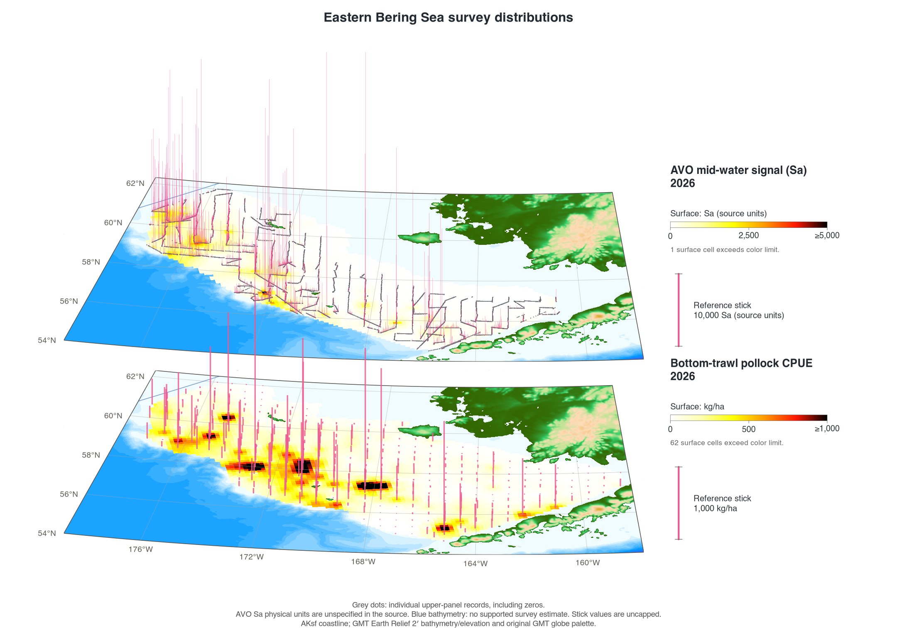
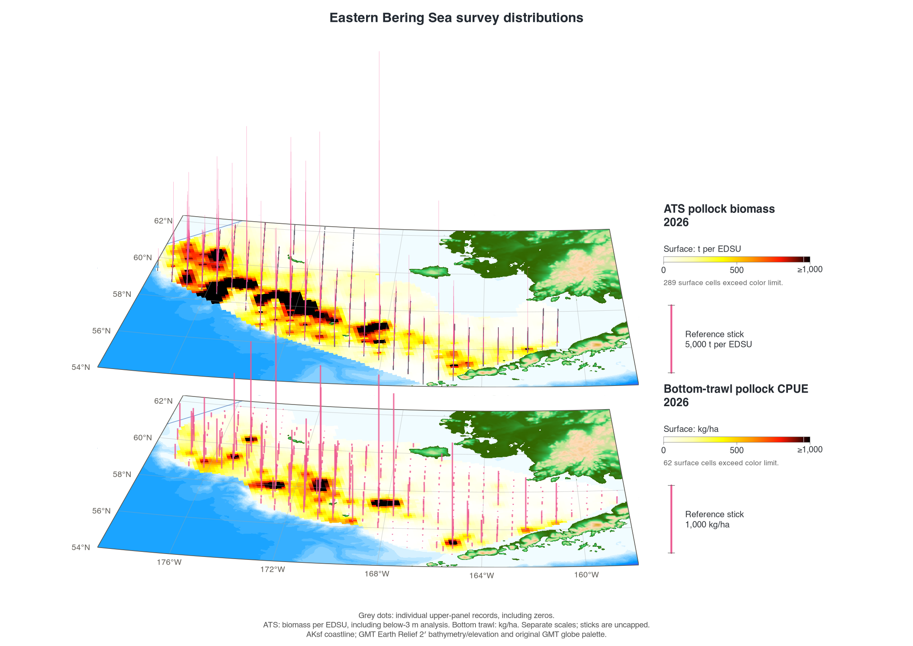
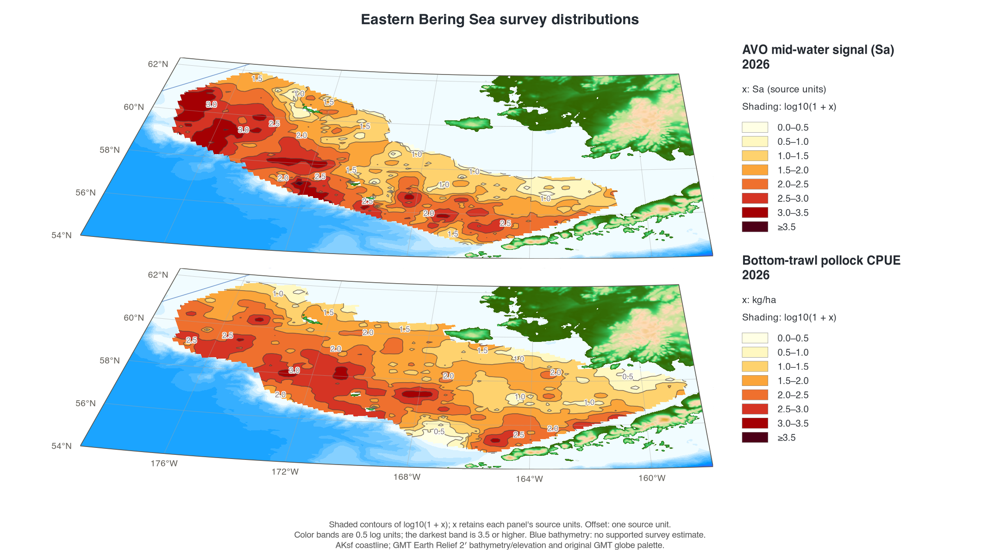
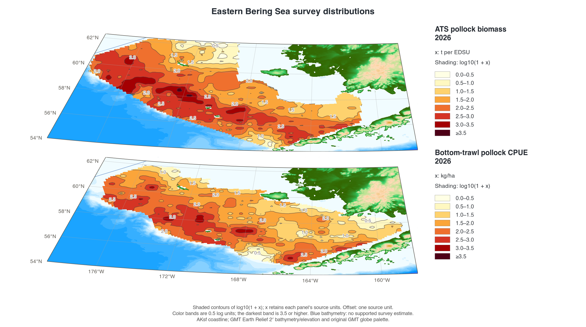
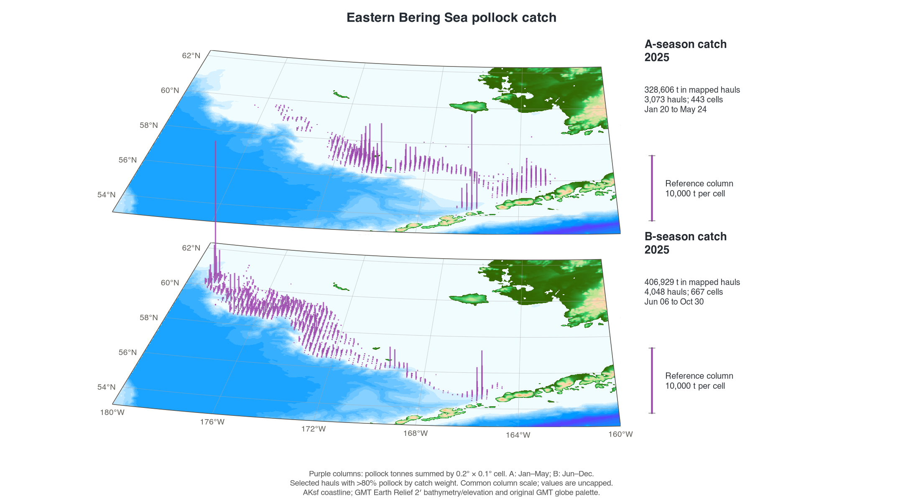
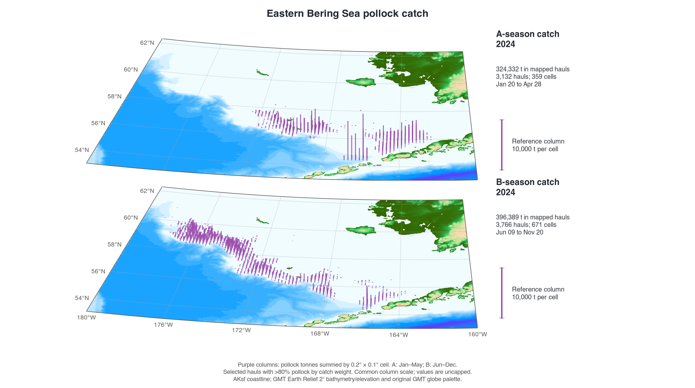
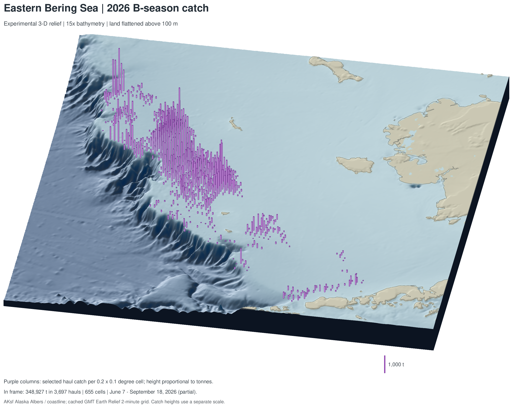

```{r setup, include=FALSE}
knitr::opts_chunk$set(collapse = TRUE, comment = "#>", fig.width = 7, fig.height = 5)
library(AKsf)
library(ggplot2)
```

AKsf supplies a common coastline and Alaska Albers coordinate system for maps
of pollock surveys and seasonal catch. This article brings together nine maps
from the pollock mapping project: bottom-trawl CPUE and temperature, AVO and
acoustic-trawl survey (ATS) comparisons, shaded log values, and seasonal catch
with bathymetry.

**Snapshot: 30 September 2026.** These saved figures use the supplied inputs;
the 2026 B-season catch extract ends on **18 September 2026**. The figures are
included unchanged for offline viewing. The runnable example below uses
**synthetic observations**. Original survey records and fishery haul extracts
are held separately from the package. The
[figure manifest](https://jimianelli.github.io/AKsf/articles/pollock-maps/figure-manifest.csv) records SHA-256 checksums for
the nine included images.

## A small, runnable AKsf example

Put one record on each row, retain its year and units, then turn longitude and
latitude into spatial points. This example needs only the installed package
and its dependencies; it downloads no data and needs no GMT installation.
Point size represents catch in tonnes, rather than a density per unit area.

```{r synthetic-points, fig.alt="Synthetic catch locations in the eastern Bering Sea. Purple circles have sizes proportional to invented catch tonnage; grey land comes from the bundled AKsf coastline."}
# Invented values for illustrating the data structure and plotting steps.
example_catch <- data.frame(
  year = rep(2026L, 6),
  season = c("A", "A", "A", "B", "B", "B"),
  lon = c(-176.5, -174.3, -170.7, -168.3, -165.4, -162.9),
  lat = c(59.5, 58.8, 57.8, 57.1, 56.1, 55.5),
  catch_t = c(250, 700, 400, 950, 600, 300)
)
stopifnot(sum(example_catch$catch_t) == 3200)

catch_points <- sf::st_as_sf(
  example_catch, coords = c("lon", "lat"), crs = 4326, remove = FALSE
)
catch_points <- sf::st_transform(catch_points, proj_aksf())

ggplot() +
  plot_coast(fill = "grey85", colour = "grey60", linewidth = 0.15) +
  geom_sf(data = catch_points, aes(size = catch_t), colour = "#a34ec4") +
  scale_size_area(max_size = 7, name = "Catch (t)") +
  coord_aksf(
    default_crs = sf::st_crs(4326),
    xlim = c(-178.8, -158), ylim = c(54, 62.3), expand = FALSE
  ) +
  theme_aksf() +
  labs(title = "Synthetic catch example", caption = "Invented observations; AKsf coastline")
```

For GMT, export the same bundled coastline with `write_gmt()`. This writes a
WGS84 GMT/OGR polygon file, preserving polygon parts and holes. The exported
coordinates are longitude and latitude; distances in the R workflow use
`proj_aksf()` (EPSG:3338, metres).

```{r synthetic-export}
coast_file <- tempfile(fileext = ".gmt")
write_gmt(get_coast(), coast_file)
stopifnot(file.exists(coast_file), file.info(coast_file)$size > 0)
unlink(coast_file)
```

See [Use AKsf boundaries in GMT](https://jimianelli.github.io/AKsf/articles/GMT.html) for the GMT 6 map commands and grid
handling. AKsf provides the geometry and export interface. The survey gridding,
paired perspectives, and terrain rendering below belong to the application
workflow.

## Survey distributions

The annual bottom-trawl panels show **2018, 2019, and 2021–2026**. The supplied
series has no 2020 panel. CPUE uses the supplied density-dependent-corrected
`ddc_cpue_kg_ha` values; the correction version and final adoption status are
unspecified in the source CSV. Bottom temperature is in degrees Celsius.
Missing temperature readings are excluded from that layer while eligible CPUE
observations remain available.


[Open full-size figure](https://jimianelli.github.io/AKsf/articles/pollock-maps/pollock_cpue_temperature_2018_2026.png)

The paired views place the two map planes close together with the same camera
and spatial alignment. Grey points mark each AVO or ATS record in the displayed
region, making the transects visible. Pink sticks retain uncapped observed
values; surface colors have their own limits.

### AVO above bottom trawl, 2026

**The 2026 AVO results are preliminary.** AVO values are **Sa in the source units**; their physical units are unspecified
in the input headers. The bottom-trawl panel remains kg/ha. The panels have
separate scales.



[Open full-size figure](https://jimianelli.github.io/AKsf/articles/pollock-maps/avo_bottom_trawl_2026.png)

### ATS above bottom trawl, 2026

ATS uses the supplied `biomass_ton` **tonnes assigned to each elementary distance
sampling unit (EDSU)**, including the source's below-3 m analysis. The source
has no EDSU-area denominator for conversion to kg/ha. All listed contributions
are positive; unlisted intervals have unknown values. These biomass
contributions and bottom-trawl CPUE retain their separate units.



[Open full-size figure](https://jimianelli.github.io/AKsf/articles/pollock-maps/ats_bottom_trawl_2026.png)

### Shaded log values

These views transform the existing interpolated values using **`log10(1 + x)`**
before color-limit clipping. Here `x` retains each panel's source units.
Missing cells remain missing. Shading uses 0.5-log-unit bands; the darkest band
starts at 3.5. A log value of 1, 2, or 3 corresponds to 9, 99, or 999 in the
original units. ATS remains a biomass contribution per interval, rather than
an area-based density.



[Open full-size figure](https://jimianelli.github.io/AKsf/articles/pollock-maps/avo_bottom_trawl_2026_log_contours.png)



[Open full-size figure](https://jimianelli.github.io/AKsf/articles/pollock-maps/ats_bottom_trawl_2026_log_contours.png)

### How the survey surfaces were made

Records were averaged in 0.3° longitude by 0.15° latitude blocks, then gridded
at 10 km in EPSG:3338. Weights are proportional to 1 / distance²;
up to eight blocks within 65 km contribute to a cell. Cells outside the
observed convex hull, search radius, map region, or ocean remain missing.
Bottom-trawl CPUE and temperature also use the archived survey polygon; AVO
and ATS use their own spatial support.

These are descriptive interpolations, with no estimated spatial prediction
uncertainty. They differ from the historical GMT `nearneighbor` and `surface`
calculations. Review the survey mask when coverage changes. Two-dimensional
annual panels use a Mercator display; paired survey views use a perspective of
the common projected coordinates.

## Seasonal fishery catch

A season is January–May and B season is June–December. The maps select hauls in
NMFS areas satisfying `500 < nmfs_area < 540`, with more than 80% pollock by
catch weight, across all source vessel types. Pollock kilograms are converted
to tonnes and summed in 0.2° longitude by 0.1° latitude cells. Columns represent
those selected source-haul totals, with no interpolation or expansion to fleet
catch-accounting totals.

### 2026: three-dimensional terrain

Both seasons share the expanded, west-shifted frame, **25° viewing elevation**,
**170° azimuth**, **15× terrain exaggeration**, and a **1,000-tonne reference
column**. Land above 100 m is displayed at 100 m. Purple columns have a constant
footprint, heights proportional to tonnes, and bases on the displayed terrain.
Their heights represent catch, rather than measured tow depth.

Within the frame, A season shows 342 cells, 2,906 hauls, and 319,734.9 t
(20 January–22 April); B season shows 655 cells, 3,697 hauls, and 348,927.1 t
(7 June–18 September). **The 2026 B season is partial.**


[Open full-size figure](https://jimianelli.github.io/AKsf/articles/pollock-maps/fishery_catch_seasons_2026.png)

### 2025 and 2024

These oblique map planes retain the original GMT elevation palette and a common
**10,000-tonne reference column**. Their frame spans 180–160°W and 53–62.3°N.
Use the reference column when comparing them with the 2026 terrain view, which
has a different column scale and camera.



[Open full-size figure](https://jimianelli.github.io/AKsf/articles/pollock-maps/fishery_catch_seasons_2025.png)



[Open full-size figure](https://jimianelli.github.io/AKsf/articles/pollock-maps/fishery_catch_seasons_2024.png)

### Experimental B-season view

This standalone 2026 B-season view retains a **36° viewing elevation**, with the
same 15× terrain exaggeration, 100 m land cap, azimuth, frame, and catch totals
as the 2026 seasonal pair.



[Open full-size figure](https://jimianelli.github.io/AKsf/articles/pollock-maps/experimental_relief_2026.png)

## Bathymetry source

The elevation raster comes from **GMT Earth Relief**, rather than AKsf. The
saved maps use cached pixel-registered **SRTM15+ Earth Relief v2.7 at 2 arc
minutes**, recorded in the local GMT catalog dated 1 May 2025, with a 10.5 km
full-width Gaussian filter. Elevations are in metres. The raster was reprojected
with bilinear interpolation to an approximately 2 km Alaska Albers display
grid. The survey and 2024/2025 catch maps use the historical GMT palette;
2026 terrain maps add illumination and vertical exaggeration. Source elevations
and catch totals retain their original values.

Grey 200 m and 500 m contour overlays and water-depth legends are omitted.
Depth-color bands remain visible, including where survey values lack support.
AKsf's bundled Natural Earth coastline supplies generalized land geometry.
See [GMT's Earth Relief documentation](https://www.generic-mapping-tools.org/remote-datasets/earth-relief.html)
for the upstream grid product and download conventions.

## Keep updates simple

For the production mapping project, keep each measurement in its own CSV with
one record per row. Retain observed zeros; use `NA` for missing measurements.
Keep dates, years, coordinates, units, and the source/correction version with
the input. Do not fill unobserved ATS intervals with zeros.

| Input | Columns used by the mapping project | Units |
|---|---|---|
| `pollock.csv` | `year`, `lon`, `lat`, `cpue_kg_ha` | kg/ha; `ddc_cpue_kg_ha` is the accepted source-column alias |
| `temperature.csv` | `year`, `lon`, `lat`, `bottom_temp_c` | °C; `gear_temperature` is the accepted source-column alias |
| `avo.csv` | `year`, `lon`, `lat`, `sa` | Sa source units; `sA` is an accepted alias |
| ATS spatial CSV | `INTERVAL`, `region`, `lon`, `lat`, `biomass_ton`, `numbers_millions` | t per EDSU and millions per EDSU; the configured year must match the interval identifiers |
| Fishery haul CSV | `year`, `haul_date`, `lon`, `lat`, `nmfs_area`, `pollwt`, `official_total_catch` | `pollwt` in kg; `official_total_catch` in t |

The first three inputs also accept `start_longitude` and `start_latitude`.
Supply one accepted name for each field. Fishery composition is checked after
accounting for the kg/t unit difference.

1. Replace or append the CSV inputs in the **mapping project**, keeping existing
   years and the same columns.
2. Point `config.R` to the inputs; set the ATS year and fishery years as needed.
   The default annual-panel selection uses the latest eight available years
   with both CPUE and temperature.
3. Run `Rscript run_maps.R` from that project. If rebuilding AVO from the source
   track files, first run `Rscript R/compile_avo.R`.
4. Review the observation counts, missing values, catch-cell totals, date
   coverage, and source manifests before sharing the refreshed figures.

The production scripts and inputs are maintained outside AKsf; installing the
package supplies the spatial geometry, not those application files. Updating
this article is a separate documentation step. From the mapping project, sync
the reviewed outputs to the package checkout and companion pollock wiki:

```bash
python3 scripts/sync_map_docs.py --aksf /path/to/AKsf --wiki /path/to/pollock/wiki
```

The sync helper refreshes the selected figure assets and path-free manifests.
Review the article's snapshot date, years, and coverage text when the inputs
change. Package vignette builds execute the synthetic example and display the
archived figures; they do not rerun the source surveys or fishery analysis.
